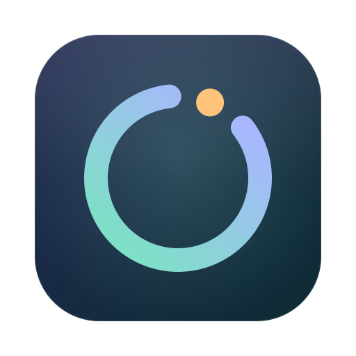
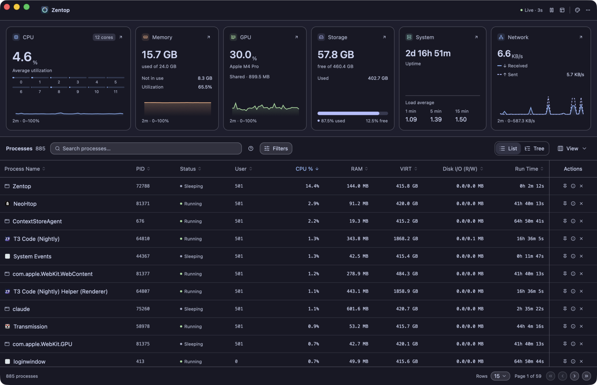
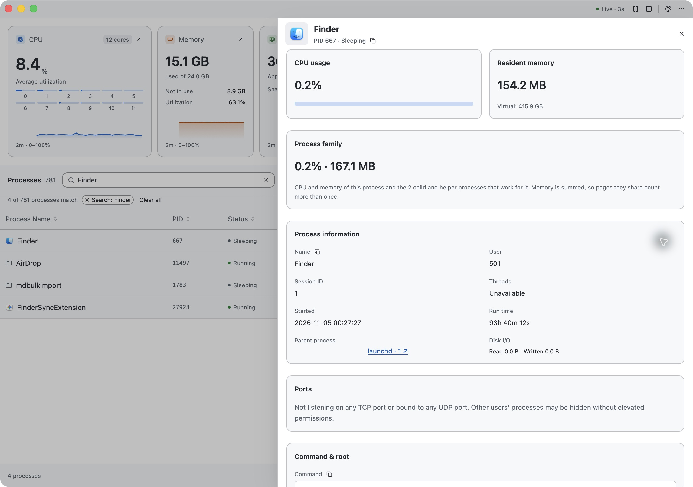
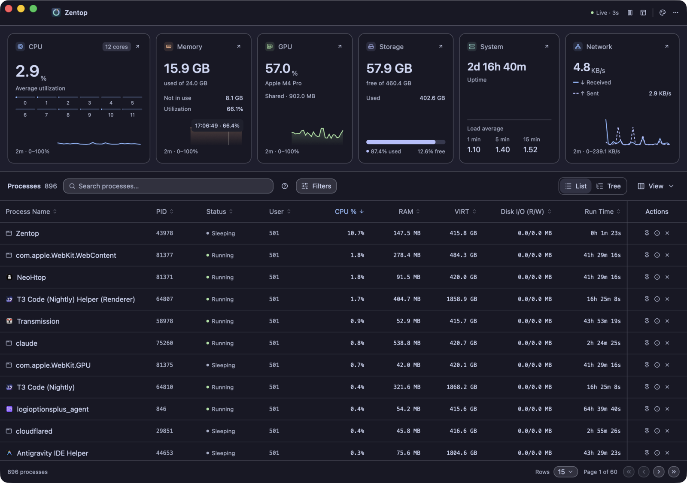
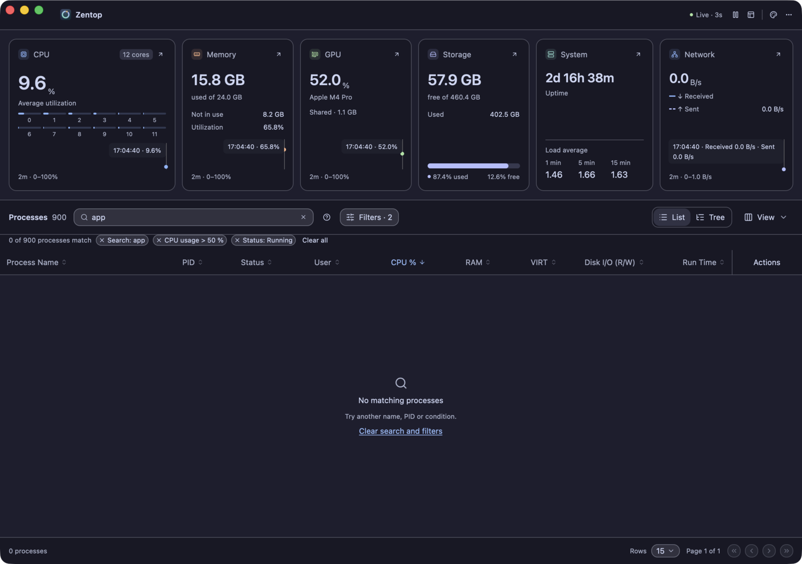
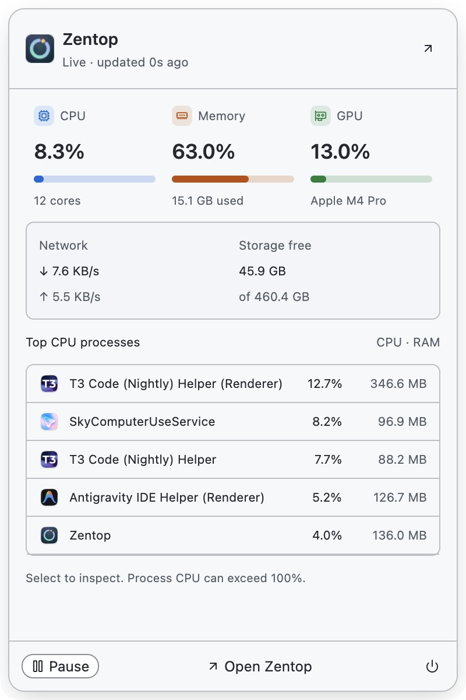

<div align="center">
  
  <h1>Zentop</h1>
  <p><strong>A calm, native system monitor.</strong></p>
  <p>See every process, understand your graphics card, and keep your whole machine in view on macOS, Linux and Windows.<br />Built in Rust with GPU-accelerated UI. Nothing leaves your machine.</p>

<a href="https://github.com/amjadjibon/zentop/releases/latest"></a>
<a href="LICENSE"></a>

  <p><a href="docs/install.md"><strong>Install</strong></a> · <a href="docs/usage.md">User guide</a> · <a href="docs/screenshots/README.md">Screenshots</a> · <a href="CHANGELOG.md">Changelog</a></p>
</div>



## What it does

- **Every process, at a glance.** Sort, search and filter by CPU, GPU, RAM, run time or status. Pin the ones you watch. Switch to **Tree** to group processes into families with combined CPU and RAM.
- **Find what owns a port.** Search `:3000` or `port:443`. Sockets are only scanned while you ask.
- **Six live resource cards.** CPU (per core), memory, GPU, storage, system load and network, each with a two-minute trend you can hover or step through with the arrow keys, and a detail sheet one click away.
- **Your graphics card, in view.** Utilization, memory, temperature, power and clocks wherever the driver exposes them.
- **A menu-bar companion.** Live readings and your five busiest processes in a small popup from the menu bar or system tray. Optionally keep monitoring after the main window closes.
- **Native icons and 24 themes.** Real app icons where the system has them; 24 color themes, each checked for readable contrast.
- **Private by design.** No analytics, no accounts, no network requests.

<table>
  <tr>
    <td width="50%"><br /><strong>Inspect any process.</strong><br /><sub>Resources, identity, parent and child processes, command line and environment, plus a confirmed end-process action.</sub></td>
    <td width="50%"><br /><strong>Read the history.</strong><br /><sub>Hover a chart, or focus it and use the arrow keys, to read any sample from the last two minutes.</sub></td>
  </tr>
  <tr>
    <td width="50%"><br /><strong>Narrow it down.</strong><br /><sub>Search terms and filters appear as chips you can remove one at a time, or clear together.</sub></td>
    <td width="50%"><br /><strong>Check without switching.</strong><br /><sub>The menu-bar overview shares its readings, pause state and theme with the main window.</sub></td>
  </tr>
</table>

## Install

Zentop has no published release yet. Build it from source:

```sh
git clone https://github.com/amjadjibon/zentop.git
cd zentop
cargo run --release
```

You need **Rust 1.88+**. On Linux, first install the GPUI and tray build dependencies (fontconfig, freetype, Wayland, xkbcommon, xcb, Vulkan, GTK 3 and AppIndicator headers); the [development guide](.github/DEVELOPMENT.md) lists the exact packages.

Installers (macOS `.dmg`, Windows setup `.exe`, Linux `.deb`, `.rpm` and AppImage) are built with cargo-packager and will be attached to [GitHub Releases](https://github.com/amjadjibon/zentop/releases) once published. See the [installation guide](docs/install.md).

## Quick tour

| You want to…                     | Do this                                                                  |
| -------------------------------- | ------------------------------------------------------------------------ |
| Find what is eating CPU or RAM   | Sort a column, add a filter, pin the process or open its details.        |
| See everything an app runs       | Switch to **Tree** and expand its family.                                |
| Find the server on your dev port | Search **`:3000`** or **`port:443`**. A bare number still matches a PID. |
| Check GPU load and memory        | Open **Graphics** from the GPU card and pick an adapter.                 |
| Look back at a spike             | Hover a chart, or click it and use the arrow keys.                       |
| Glance at the system mid-task    | Click the ring icon in the menu bar or system tray.                      |
| Change the pace or the look      | **Settings** (⌘, / Ctrl+,) for the refresh interval and themes.          |

Shortcuts: **⌘F / Ctrl+F** search · **⌘, / Ctrl+,** Settings · **⌘W** close window · **⌘Q / Ctrl+Q** quit.

More in the [user guide](docs/usage.md).

<details>
<summary><strong>GPU support by platform</strong></summary>

| Platform | Sources                                                                       |
| -------- | ----------------------------------------------------------------------------- |
| macOS    | IORegistry utilization and Apple silicon shared-memory and core data.         |
| Linux    | AMD amdgpu sysfs and NVIDIA NVML; DRM inventory for other adapters.           |
| Windows  | NVIDIA NVML; DXGI inventory and reported dedicated memory for other adapters. |

Counters such as temperature, power and clock appear only where the driver exposes them; missing values stay "Unavailable" rather than showing zero. The optional per-process **GPU %** column and filter use Linux DRM engine accounting.

</details>

## Privacy

Zentop sends nothing. There are no analytics, launch counts or update checks; process names, commands, searches and system readings never leave your machine. "Check for updates" simply opens the releases page in your browser.

## Development

Zentop is a single Rust crate built with [GPUI Kit](https://gpui-kit.com) (Zed's GPU-accelerated UI framework plus gpui-component). System sampling lives in `src/`, the windows in `src/ui/`, and themes in `assets/themes.json`.

```sh
cargo run          # debug build
cargo test         # unit tests, including theme contrast checks
cargo clippy --all-targets -- -D warnings
```

See the [development and release guide](.github/DEVELOPMENT.md) and [contributing notes](.github/CONTRIBUTING.md). Report bugs on [GitHub Issues](https://github.com/amjadjibon/zentop/issues).

## Credits

Zentop is a fork of [**NeoHtop**](https://github.com/Abdenasser/neohtop) by [Abdenasser](https://github.com/Abdenasser). It replaces NeoHtop's Tauri and Svelte webview with a native Rust app built on GPUI. Its features, themes and much of its design come from NeoHtop. Thank you.

Zentop is released under the [MIT License](LICENSE). NeoHtop's MIT license and copyright notice are kept in [licenses/neohtop-MIT.md](licenses/neohtop-MIT.md).
