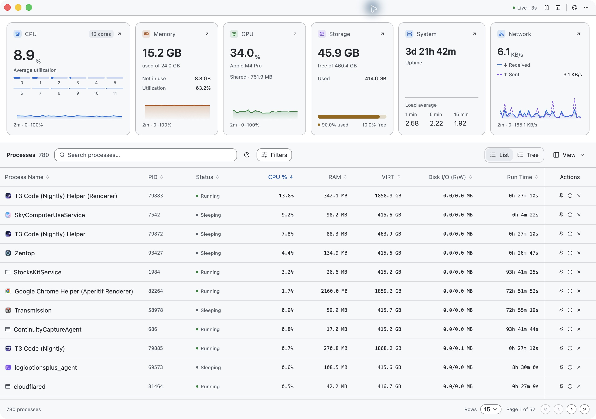
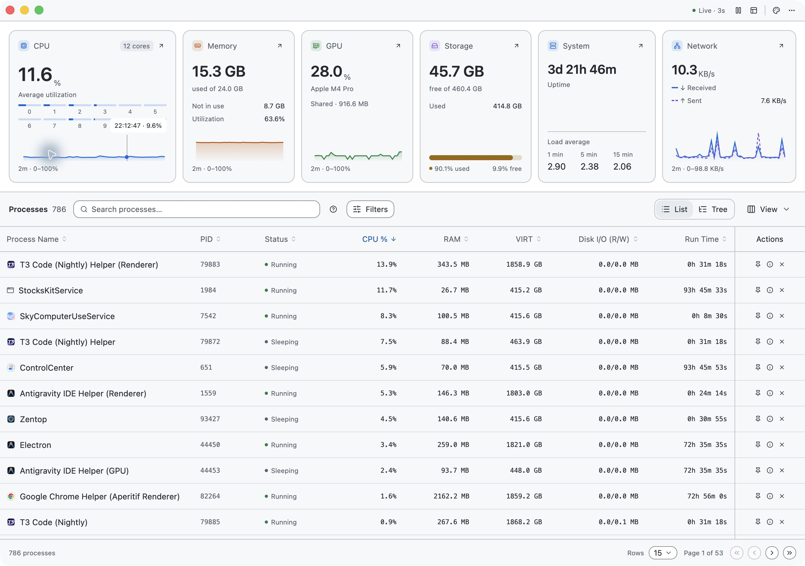
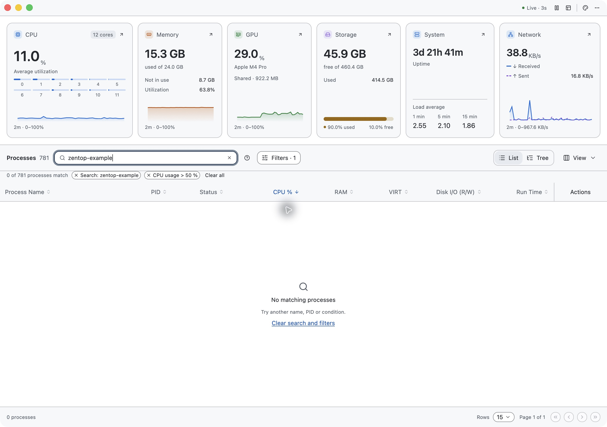
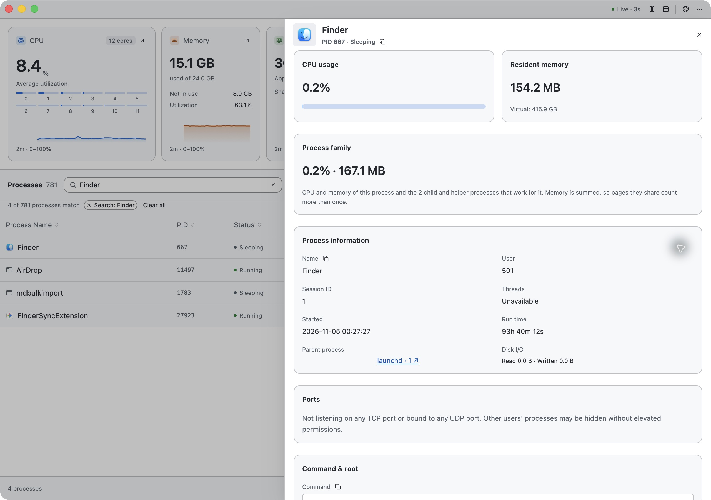
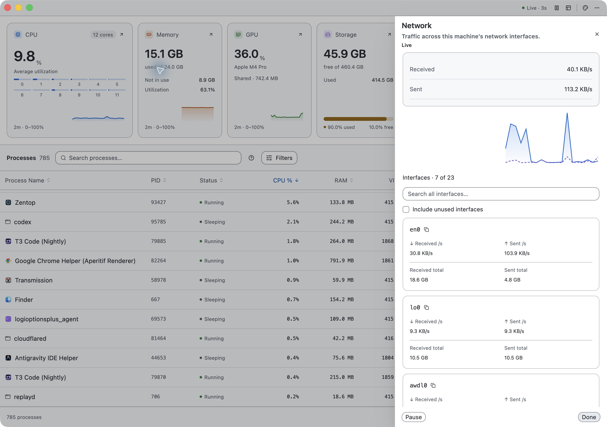
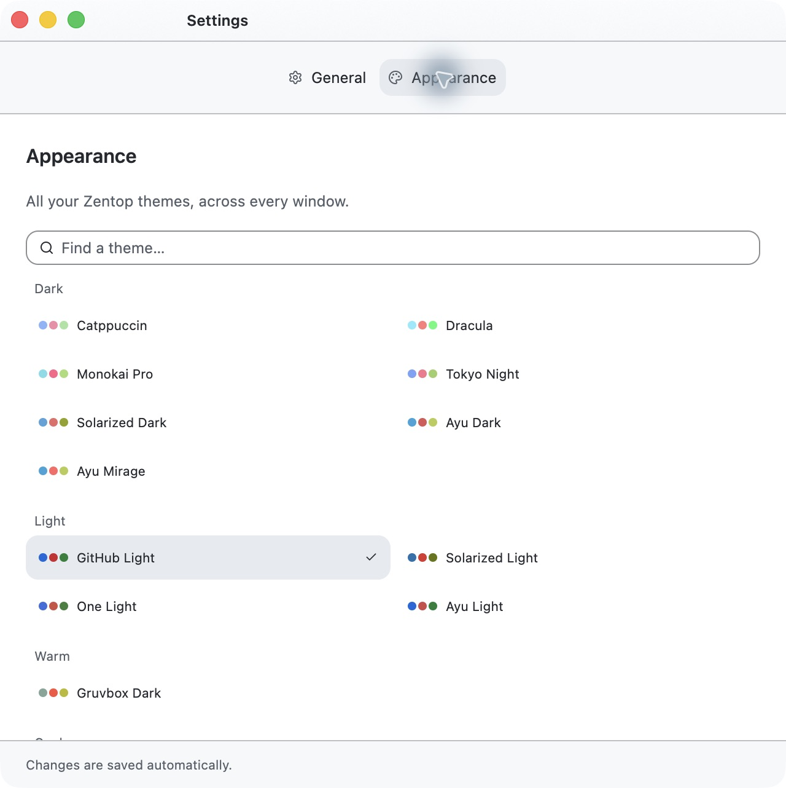
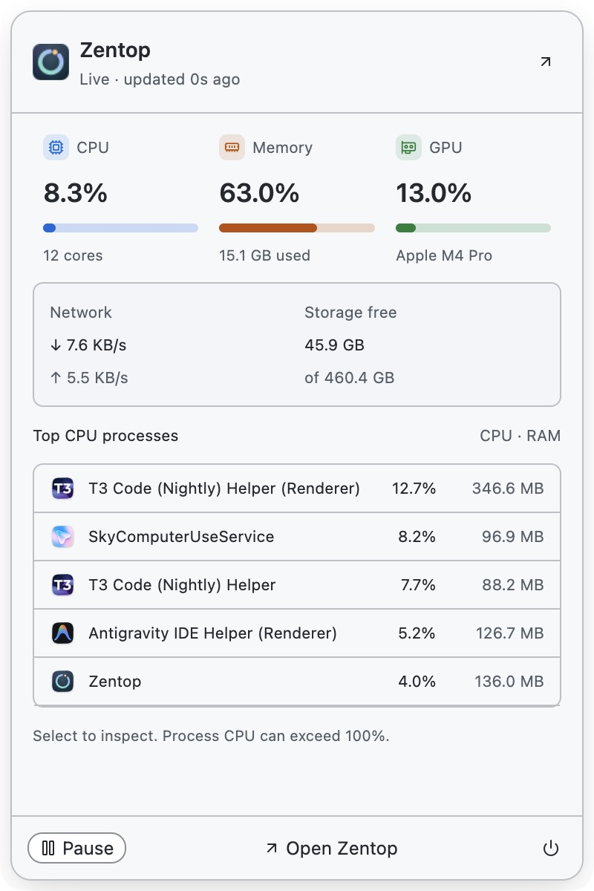
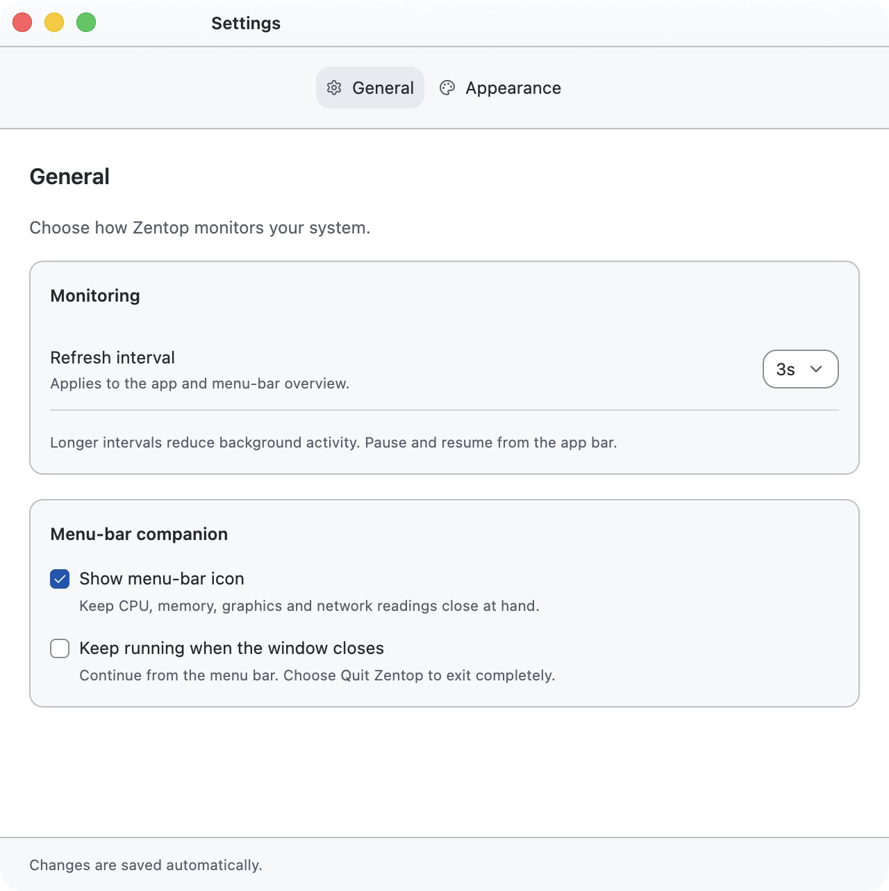
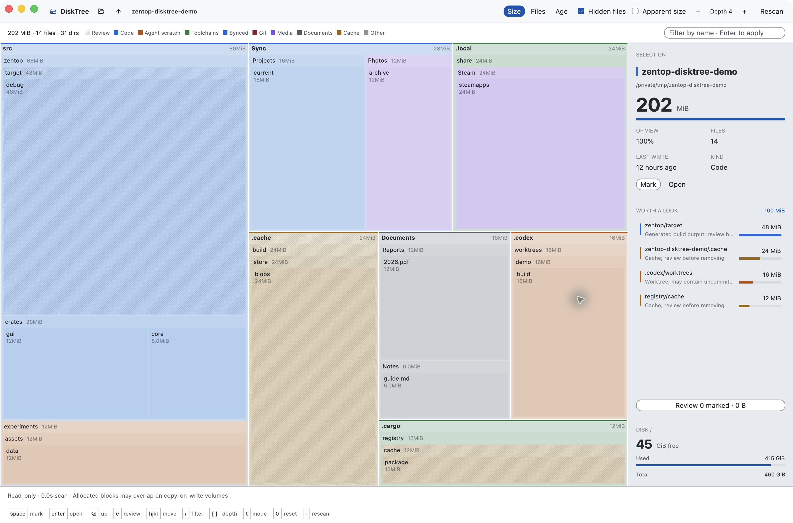
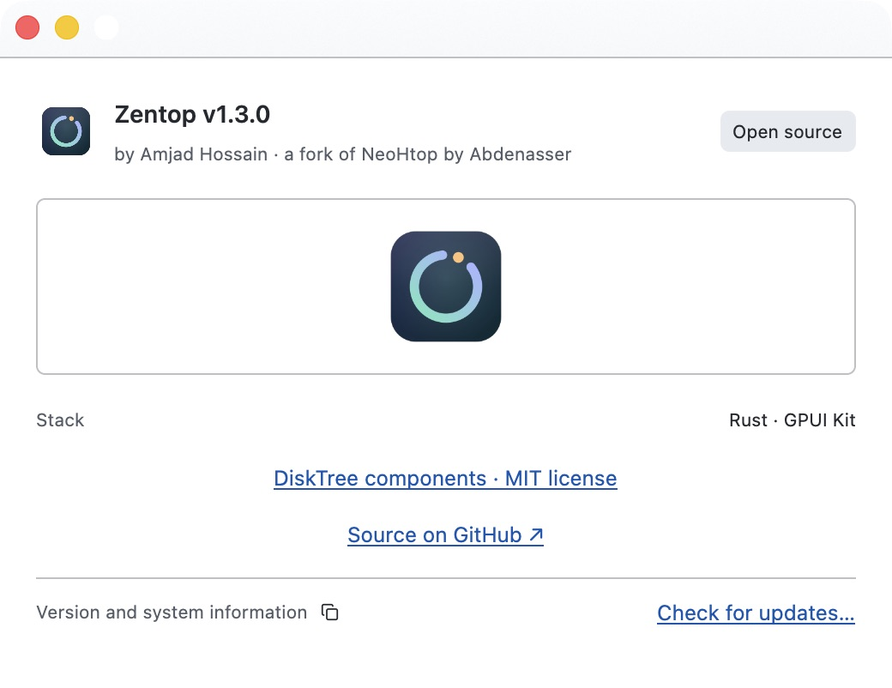

# Zentop screenshots

Captured from Zentop v1.3.0 on macOS on November 8, 2026, using the GitHub Light theme and the build at `9c2a8c6`. The DiskTree image was refreshed on November 9 for the shared GUI/TUI theme palette changes. These are native Retina window captures. Monitoring readings come from a real machine and are examples, not benchmarks; GPU details and window chrome vary by platform and driver.

DiskTree scans a generated demo folder containing source, build output, caches, synced files, documents and game data. Its sample files illustrate the interface without exposing personal directories.

## Main window

Resource cards with two-minute trends above the process list. The Actions column stays pinned on the right.

## Chart inspection

Hover a chart, or focus it and use the arrow keys, to read the time and value of any sample.

## Search and filters

Active search terms and filters appear as removable chips, with a clear-all action and an empty state when nothing matches.

## Process details

## Network details

## Theme picker

The searchable theme gallery in Settings → Appearance.

## Menu-bar overview

## Settings

## DiskTree

The themed top bar, nested treemap, review-candidate hatching, selection details and disk capacity.

## About

Includes the DiskTree components’ MIT license link.

See the [user guide](../usage.md) for workflows, shortcuts and platform notes.
